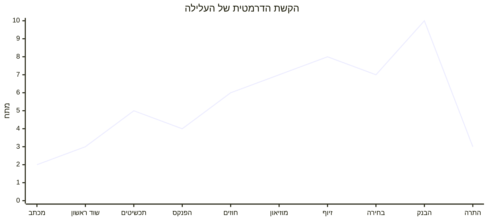
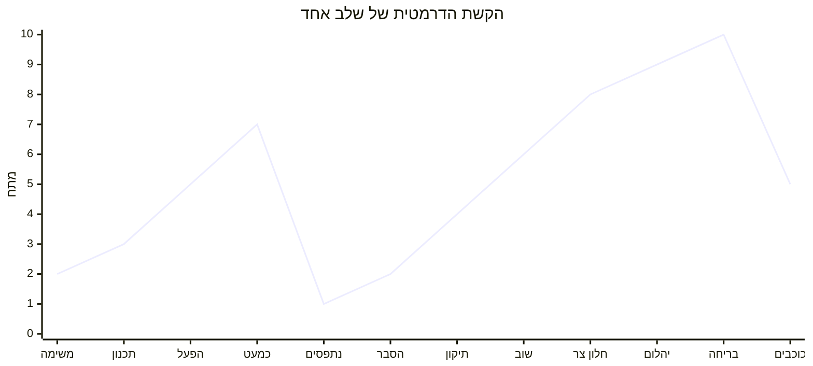

# השוד המושלם: רכיבים דרמטיים | PERFECT HEIST – Dramatic Elements

**מטלה 5** בקורס פיתוח משחקי מחשב.
**חברי הצוות:** כפיר נזרי, אביתר אהרון.

<!-- חלוקה: סעיפים 1, 2, 4, 7, 10 – כפיר; סעיפים 3, 5, 6, 8, 9 – אביתר. כל אחד עורך רק את הסעיפים שלו, ועושה pull לפני כל push. -->

## 1. אתגר

### כישורים נדרשים

| כישור | איפה הוא נדרש במשחק | דוגמה |
|---|---|---|
| **קריאת מפה וחשיבה מרחבית** | לפני התכנון: מזהים מסלולי סיור, טווחי מצלמות, דלתות ודרכים חלופיות | לראות שמסדרון השירות עוקף את הלובי, ושפתח האוורור מחוץ לטווח של CAM3 |
| **חישוב תזמון** | בתכנון: מחשבים מתי כל דמות נמצאת בכל משבצת, ביחס לחלונות שבהם האבטחה כבויה | "המצלמה כבויה בשניות 3–11 של ההרצה. המתגנב חוצה את הטווח שלה בשנייה 6, ולכן לא ייראה" |
| **תיאום כמה צירי זמן** | בתכנון: 2–4 דמויות שהפעולות שלהן חייבות להשתלב | ברמה הקשה, שני הלוחות של הדלת הכפולה צריכים להילחץ בהפרש של שנייה אחת לכל היותר |
| **הסקת מסקנות מכישלון** | אחרי הרצה שנכשלה: מבינים מהודעת הכישלון מה לתקן | "Sneak was seen by the guard at second 13.0" ← מזיזים את פקודת ההליכה שלו 2 שניות קדימה |
| **פתרון חידות** | ברמה הבינונית והקשה: קוד הכספת | 4 ציורים בצבעים, ופתק "מהצבע הקר ביותר אל החם ביותר" ← 3917 |
| **תקשורת** (במצב זוגי) | חלוקת הדמויות בין השחקנים והסכמה על תוכנית אחת | "אני מסיח את השומר בשנייה 8, אז תתחיל ללכת בשנייה 9" |

אין צורך במהירות תגובה או בדיוק של יד: אחרי "הפעל" השחקן לא שולט בדמויות, ולזמן התכנון אין הגבלה.

### שלוש רמות קושי לבחירה ידנית

השחקן בוחר רמה במסך הבית, לפני בחירת השוד. כל רמה היא asset של **`DifficultySettings`**, ‏ScriptableObject אחד שמחזיק את כל הערכים שמשתנים. `GameManager` שומר את הרמה שנבחרה, וכל אובייקט במשחק קורא ממנה את הערכים שלו, במקום מספרים שכתובים בקוד.

ה־ScriptableObject מוגדר עם `CreateAssetMenu` (תפריט "Perfect Heist ← Difficulty Settings"), כך שיוצרים את שלוש הרמות מתוך Unity בלי קוד. השדות שלו:

| שדה | סוג | משמעות |
|---|---|---|
| `displayName` | טקסט | שם הרמה במסך: Easy / Medium / Hard |
| `teamSize` | מספר שלם | כמה דמויות חובה לבחור לצוות |
| `cameraRadius` | עשרוני | רדיוס הראייה של מצלמה, בתאים |
| `secondsToCapture` | עשרוני | כמה שניות עוברות מהאזעקה עד שהדמות נתפסת |
| `cameraDisableSeconds` | עשרוני | משך היכולת של ההאקר (כיבוי מצלמה) |
| `distractSeconds` | עשרוני | משך היכולת של המתחזה (הסחת שומר) |
| `laserDisableSeconds` | עשרוני | משך היכולת של הטכנאי (כיבוי לייזר) |
| `lockpickSeconds` / `lockpickOthersSeconds` | עשרוני | זמן פתיחת דלת נעולה לפורץ / לכל דמות אחרת |
| `safeOpenSeconds` / `safeOpenOthersSeconds` | עשרוני | זמן פתיחת כספת לפורץ / לכל דמות אחרת |
| `runTimeLimit` | עשרוני | חלון זמן להרצה. 0 פירושו בלי חלון זמן |
| `safeCode` | enum ‏`SafeCodeType` | סוג קוד הכספת: None / Split / Riddle |
| `abilityUsesPerAttempt` | מספר שלם | כמה פעמים אפשר להשתמש בכל יכולת פעילה בניסיון אחד |

הערכים בשלושת ה-assets (לפי [תכנון הרמות](Level_Design.md)), ואיזה קוד קורא כל אחד:

| שדה | קלה | בינונית | קשה | מי משתמש בו |
|---|---|---|---|---|
| `teamSize` | 2 (שלישית אופציונלית בשלבים מתקדמים) | 3 | 4 | `TeamSelectScreen`: כפתור "המשך" נפתח רק כשנבחרו `teamSize` דמויות |
| `cameraRadius` | 3 | 4.5 | 4.5 | `SecurityCamera.Init(map, cell, radius)` |
| `secondsToCapture` | 15 | 8 | 5 | `RunClock.ReportDetected`: במקום כישלון מיידי, מפעיל אזעקה וטיימר תפיסה |
| `cameraDisableSeconds` | 8 | 6 | 5 | `DisableCameraCommand.Seconds` |
| `distractSeconds` | 6 | 5 | 4 | פקודת הסחת הדעת של המתחזה |
| `laserDisableSeconds` | 8 | 6 | 5 | פקודת השבתת הלייזר של הטכנאי ושל מסוף האבטחה |
| `lockpickSeconds` / `lockpickOthersSeconds` | 3 / 8 | 4 / 10 | 5 / 12 | פקודת פתיחת דלת נעולה |
| `safeOpenSeconds` / `safeOpenOthersSeconds` | 4 / 10 | 6 / 14 | 8 / 18 | פקודת פתיחת כספת |
| `runTimeLimit` | 0 | 0 | 55 | `RunClock.Update`: אם `RunTime > runTimeLimit` השוד נכשל. ציר הזמן מצייר קו אדום בשנייה הזו |
| `safeCode` | None | Split (קוד מפוצל לשני רמזים) | Riddle (חידה) | `LevelSpawner`: אילו פתקים ורמזים להציב במפה |
| `abilityUsesPerAttempt` | 2 | 2 | 2 | מונה השימושים שמוצג ליד כל דמות |

**עצמים שמשתנים בין הרמות:** לכל שלב יש פריסת מפה אחת, וכל עצם בה מסומן ברמה המינימלית שבה הוא מופיע. `LevelSpawner` מציב רק את העצמים שהרמה שלהם קטנה או שווה לרמה שנבחרה. במפת הדוגמה:

| עצם | קלה | בינונית | קשה |
|---|---|---|---|
| שומרים | G1 (סיבוב כל 15 שניות), G2 | + G3 במסדרון השירות | G1 מהיר יותר: סיבוב כל 12 שניות |
| מצלמות | CAM1, CAM2 | + CAM3 | + CAM4 |
| דלת הכספת | דלת נעולה רגילה | דלת נעולה רגילה | דלת כפולה עם שני לוחות |
| פתח האוורור | פתוח | פתוח | חסום בסורג (רק טכנאי פותח) |
| רמזים לקוד | אין | מסוף + פתק | 4 ציורים + פתק |

**מה לא משתנה:** המפה, מסלולי הסיור (חוץ מהמהירות של G1 ברמה הקשה), ובעיקר **זמן התכנון, שאין לו הגבלה בכל הרמות**.

### התאמת קושי דינמית

**האילוץ:** במשחק הזה התוכנית נשמרת בין ניסיונות. אם נשנה את תזמון השומרים באמצע שלב, נשבור לשחקן תוכנית שכמעט עבדה, ונסתור את העיקרון "בלי מזל: כישלון תמיד נובע מהתוכנית". לכן ההתאמה פועלת בשתי שכבות, ואף אחת מהן לא משנה את העולם בזמן שהשחקן עובד על תוכנית.

**שכבה 1: בתוך שלב – עזרה הדרגתית אחרי כישלונות.** `GameManager.Attempts` כבר סופר ניסיונות. מחלקה חדשה, `AssistLadder`, בודקת אותו בכל חזרה לתכנון (`RunClock.ResetToPlanning`):

| כישלונות רצופים באותו שלב | העזרה | למה היא לא שוברת את התוכנית |
|---|---|---|
| 3 | **"רוח" של הניסיון הקודם:** בזמן התכנון מוצגת דמות שקופה במקום ובשנייה שבהם הדמות נתפסה, יחד עם שדה הראייה שתפס אותה | רק תצוגה, לא משנה שום ערך |
| 5 | **זמן תפיסה ארוך יותר:** `secondsToCapture += 3` עד סוף השלב | מסלולי השומרים והמצלמות לא זזים, ולכן אותה תוכנית תתנהג אותו דבר עד רגע האזעקה |
| 7 | **סימון המכשול הבעייתי:** המכשול שגרם לרוב הכישלונות (לפי `seenBy` של `ReportDetected`) מהבהב במפה, עם רמז כללי כמו "המצלמה הזו רואה את המסדרון כל הזמן" | לא חושף פתרון, רק מצביע על הבעיה |

העזרה לא משנה את חוקי הדירוג: שוד שהצליח אחרי יותר מ־5 ניסיונות מקבל ★ אחד בכל מקרה.

**שכבה 2: בין שלבים – כיול לפי מיומנות.** מחלקה חדשה, `SkillTracker`, שומרת לשלושת השודים האחרונים: מספר ניסיונות עד הצלחה, כמות כוכבים, וסוג הכישלון הנפוץ (שומר / מצלמה / קוד שגוי / חלון זמן). כשנכנסים לשלב חדש, היא מחשבת מצב:

| מצב | התנאי | מה משתנה בשלב הבא |
|---|---|---|
| **שולט** | ★★★ בשני השודים האחרונים, ב־2 ניסיונות לכל היותר בכל אחד | `cameraRadius += 0.5`, משכי היכולות `-1` שנייה |
| **רגיל** | כל השאר | בלי שינוי |
| **מתקשה** | יותר מ־5 ניסיונות בשניים מתוך שלושת השודים האחרונים | `cameraRadius -= 0.5`, משכי היכולות `+1` שנייה |

**גבולות:**
- ההתאמה אף פעם לא עוברת את הערכים של הרמה השכנה. למשל, ברמה הקלה רדיוס המצלמות נשאר בין 3 ל־4.5. כך הבחירה הידנית של הרמה תמיד משמעותית.
- **זמן התכנון לא נמדד ולא משפיע**, לפי העיקרון שאין לחץ זמן בתכנון.
- כרטיס המשימה מציג לשחקן שהאבטחה "תוגברה" או "הוקלה", כדי שהשינוי לא יפתיע אותו.
- את הערכים של `+0.5` ו־`+1` שומרים כשדות ב־`DifficultySettings`, לא כמספרים בקוד, וכך אפשר לכוון אותם גם מה־Live Ops (סעיף 10).

## 2. זרימה

### מיקוד תשומת הלב ומניעת הסחות דעת

| מה | איך זה עובד |
|---|---|
| **מסך תכנון נקי** | רואים רק את המפה ואת ציר הזמן. רק ציר הזמן של הדמות שנבחרה פתוח, והשורות של שאר הדמויות מוצגות חלשות, רק לתיאום. ב־`PlanningUI` כל שורה מקבלת מצב מודגש או מעומעם (כבר קיים: שקיפות `0.10` לשורה שנבחרה מול `0.03` לשאר) |
| **אין שום דבר זז בזמן התכנון** | לא רץ שעון, השומרים לא זזים בעצמם ואין הודעות קופצות. העולם זז רק כשהשחקן גורר את סמן הזמן ב־`TimelineScrubber`, שמעדכן את `RunClock.PreviewTime` |
| **בזמן ההרצה ממשק התכנון נעלם** | ב־`RunClock.OnRunStarted` מסתירים את הכפתורים, ונשארים רק המפה ושעון ההרצה. אין במה לגעת, אז כל הקשב על הדמויות |
| **ההדרכה מסמנת דבר אחד בכל פעם** | ב־`GuideOverlay` רק האובייקט שבתוך ההילה הזהובה לחיץ, וכל השאר מוחשך |
| **צבעים לפי משמעות** | אדום לסכנה (שדות ראייה, לייזר, פקודת כיבוי מצלמה), זהב ליהלום וליציאה, ולכל דמות צבע משלה (בטבלה למטה). אין צבעים חזקים בשום מקום אחר |

**צבע לכל דמות** (מ־`PlanningUI.RoleColor`). הצבע מופיע על קו המסלול במפה, על שם הדמות בציר הזמן ועל הדמות עצמה, כך שבמבט אחד יודעים איזה מסלול שייך למי:

| דמות | צבע | RGB |
|---|---|---|
| האקר – דני "פיקסל" | תכלת | `(0.2, 0.75, 1)` |
| מתגנב – לוקאס "שאדו" | סגול | `(0.75, 0.5, 1)` |
| פורץ – רפאל "ביגמן" | כתום | `(1, 0.6, 0.2)` |
| מתחזה – אנה "מאסק" | ירוק | `(0.35, 0.85, 0.4)` |
| טכנאי – דייויד "הנדימן" | ורוד | `(1, 0.45, 0.7)` |

### תחושת שליטה

| מה | איך זה עובד |
|---|---|
| **המשחק דטרמיניסטי** | `RunClock` מקדם את הזמן בצעדים קבועים ב־`FixedUpdate`, ומסלולי הסיור קבועים, לכן אותה תוכנית תמיד נותנת אותה תוצאה. כישלון תמיד נובע מהתוכנית ולא ממזל |
| **רואים מראש את התוצאה של כל פקודה** | גוררים את סמן הזמן לכל שנייה ורואים איפה יהיו כל הדמויות וכל השומרים (`Guard.ShowAt(PreviewTime)`, `Character.ShowAt(PreviewTime)`) |
| **אפשר לשנות הכול** | מוסיפים, מוחקים וגוררים פקודות, ויש Undo (מחסנית של פקודות שנמחקו או זזו). אין מגבלת זמן לתכנון ואין מגבלה על מספר השינויים |
| **התוכנית נשמרת אחרי כישלון** | `ResetToPlanning` מחזיר לשנייה 0 אבל שומר את הפקודות, ומשנים רק את מה שנכשל |
| **בחירות אמיתיות** | בוחרים איזה צוות לקחת (`TeamSelectScreen`) ובאיזו דרך ללכת. לכל שלב יש לפחות שני פתרונות, למשל לכבות מצלמה או לעקוף אותה |

### משוב על הצלחה וכישלון

| מתי | המשוב |
|---|---|
| **בזמן התכנון** | פקודת הליכה למקום חסום מציגה מסלול אדום. אם המסלול של דמות עובר בתוך שדה ראייה בשנייה מסוימת, הרגע הזה מסומן באדום על ציר הזמן (בודקים `Guard.CanSee` לכל שנייה בתצוגה המקדימה) |
| **בזמן ההרצה** | כשדמות מתקרבת לשדה ראייה, השדה מהבהב ומשמיעים צליל מתח. כל פעולה שמצליחה (מצלמה כבויה – החרוט הופך אפור, דלת נפתחת) מקבלת אנימציה קטנה וצליל קצר |
| **זיהוי: אזעקה** | בשלבים רגילים זיהוי לא מסיים את ההרצה. `RunClock.ReportDetected` מדליק אזעקה: אור אדום מסתובב, צפירה, והדמות שנראתה מסומנת. מעל המפה מופיע טיימר יורד של `secondsToCapture` (סעיף 1), והשומרים רצים לנקודה שבה הדמות נראתה. התוכנית ממשיכה לרוץ כמו שהיא, והשחקן רק צופה אם הצוות יספיק לברוח. בהדרכה (`tutorialMode`) זיהוי עדיין מסיים את ההרצה מיד |
| **כישלון** | כשהטיימר מגיע ל־0 לפני שהרכב יצא, או ששומר מגיע לדמות, ההרצה קופאת, המסך מהבהב באדום, והדמות שנתפסה נצבעת אדום (`Character.MarkDetected`). מופיעה הודעה מדויקת מ־`RunClock.End`, למשל "Sneak was seen by the guard at second 13.0 and caught at second 21.0", ועל המפה מופיע סימן במקום שבו הדמות נראתה. אחרי `failPause` חוזרים לתכנון |
| **הצלחה** | הרכב נוסע מהמפה (`ExitZone.StartDriving`) ומתנגנת מוזיקת ניצחון. אחר כך `WinScreen` מציג את זמן ההרצה, מספר הניסיונות והכוכבים, והראיה החדשה נוספת ללוח במחבוא (סעיף 9) |

## 3. שעשוע

### דברים נחמדים שאינם קשורים ישירות למטרה

לפני RUN אפשר לגרור את סמן הזמן ולבדוק איפה מסלולי הצוות והשומרים מצטלבים. נוסיף אפשרות לשכפל תוכנית לטיוטה ולהחליף בין הגרסאות. למשל, בתכשיטי אורו אפשר להשוות בין שימוש בטכנאי להגעה למסוף שמכבה את הלייזר. עריכה ותצוגה מקדימה אינן נספרות כניסיונות.

### סוגי השחקנים שהמשחק מתאים להם

מתכננים נהנים מתיאום פקודות בין הדמויות. הישגיים יכולים לשחק שוב לשיפור הדירוג. במצב הזוגי המקומי, שחקנים חברתיים יכולים לחלק ביניהם את הדמויות ולאשר את ההרצה יחד.

### התאמה לסוגי שחקנים נוספים

לחוקרים נציע לחפש דרכים נוספות לפתור שוד שכבר השלימו. לשחקנים שאוהבים להתנסות בתזמון נציע אתגר רשות. למשל, בתכשיטי אורו נסו להעביר שתי דמויות דרך הלייזר בהשבתה אחת ובלי פקודת המתנה. במסך התוצאה יוצג אם האתגר הושלם, והשלמתו אינה תנאי לניצחון.

## 4. רגשות

### הרגשות שהשחקן ירגיש

| רגש | מתי |
|---|---|
| **סקרנות** | בתדריך ובתכנון: "איך עוברים את המסדרון הזה?". וגם בעלילה: האם היהלום באמת מזויף? |
| **מתח** | בזמן ההרצה, כשאי אפשר להתערב ורק צופים אם התזמון עובד. הוא חזק במיוחד ב"חלון הצר", ובזמן אזעקה כשהטיימר יורד |
| **תסכול שהופך לתובנה** | כשנכשלים, ומיד אחרי זה מבינים מה בדיוק השתבש |
| **גאווה ו"אאוריקה"** | כשתוכנית שבנית בעצמך עובדת עד השנייה |
| **כעס על היריב ורצון בצדק** | כלפי קושובייב, שהפליל את סופי |

בכל שלב הרגשות מגיעים ברצף: סקרנות, מתח, תסכול, תובנה, מתח גבוה יותר ובסוף גאווה. זו קשת 2 בסעיף 7.

### איך העיצוב יוצר את הרגשות

| רגש | מה בעיצוב יוצר אותו | בקוד |
|---|---|---|
| סקרנות | הגדרת יעד ברורה, בלי פתרון. מכשולים חדשים נחשפים בהדרגה, ובכל שוד יש רמז לעלילה (פנקס, יהלום מזויף) | `HeistDefinition.storyPassage`, לוח הראיות במחבוא |
| מתח | חלוקה ל"תכנן ואז צפה": בזמן ההרצה אין כפתורים. אזעקה עם טיימר יורד, מוזיקה שמאיצה ככל שהזמן עובר, ושדות ראייה שמהבהבים כשמתקרבים אליהם | `RunClock.OnRunStarted` מסתיר את הממשק. ה־`pitch` של המוזיקה עולה לפי הזמן שנשאר בטיימר האזעקה (`secondsToCapture`) |
| תסכול שהופך לתובנה | משחק דטרמיניסטי, הודעת כישלון מדויקת, התוכנית נשמרת, ו"רוח" של הניסיון הקודם. הכישלון תמיד הוגן | `RunClock.End(reason)`, `ResetToPlanning`, `AssistLadder` (סעיף 1) |
| גאווה | אין פתרון אחד נכון, אז הפתרון הוא של השחקן. כוכבים לפי ניסיונות. זמן התכנון לא נספר, כדי שלא ילחץ | `StarRules` (סעיף 9) |
| כעס על היריב | המכתב מסופי, ראיות שמצטברות ומראות את השחיתות, וקושובייב מופיע בחדשות כ"גיבור העיר" | קטעי Twine‏ `Letter` ו־`MuseumAfter`, לוח הראיות |

## 5. סיפור רקע

### מה קרה לפני שהמשחק התחיל

לפני שלוש שנים התגלה ניסיון פריצה למוזיאון העיר, שבו מוצג היהלום ״לב הייסטרפורט״. היהלום נשאר בתצוגה, אבל בזירה נמצאו הסרטוטים של סופי אלברז, מתכננת השודים שאימנה את הצוות, והיא נשלחה לכלא. מכתב שמגיע ממנה למוסך בנמל טוען שאלכס קושובייב, הבעלים של ״קושובייב אבטחה״, החברה הפרטית ששומרת על המוזיאון, החליף בסתר את היהלום בזיוף, ביים את הפריצה והפליל אותה. לפי סופי, היהלום שבתצוגה מזויף והמקורי אצל קושובייב. היא מבקשת מהם לעקוב אחרי הכסף.

### איך השחקן לומד את סיפור הרקע

בכניסה הראשונה לקמפיין יוצג המכתב וכפתור מעבר לאימון. במדריך פיקסל ושאדו מתרגלים על יהלום מזכוכית. אחרי האימון יתווסף המכתב ללוח הראיות. אחרי תכשיטי אורו יתווסף פנקס החשבונות שמקשר את החנות למוזיאון, ואחרי המוזיאון יתווסף היהלום המזויף. לחיצה על ראיה תפתח את תיאור הממצא ומקורו.

## 6. דמויות

### דמויות מרכזיות: הגיבור והמתנגד

הגיבור הוא הצוות שסופי אימנה. היריב הוא אלכס קושובייב, הבעלים של חברת האבטחה הפרטית ״קושובייב אבטחה״, ששומרת על תכשיטי אורו, על המוזיאון ועל הבנק המרכזי. הוא מחזיק את היהלום האמיתי בכספת הפרטית שלו.

| חבר צוות | יכולת | אופי ומניע מוצעים |
| --- | --- | --- |
| דני ״פיקסל״, האקר | השבתת מצלמות וגילוי מסלולי שומרים | ספקן, מחפש ראיות שאפשר לאמת |
| רפאל ״ביגמן״, פורץ | פתיחת מנעולים וכספות ונשיאת פריטים | מעשי, רוצה לראות מה הכספת מסתירה |
| לוקאס ״שאדו״, מתגנב | תנועה שקטה ומעבר בנתיבי שירות צרים | סבלני, רוצה להוכיח שהצוות עדיין מתואם |
| אנה ״מאסק״, מתחזה | הסחת שומרים ומעבר באזורי אורחים | קוראת אנשים היטב, בוחנת במי כדאי לסמוך |
| דייויד ״הנדימן״, טכנאי | השבתת לייזרים ופתיחת מעברי שירות | סקרן, שואל למה חנות קטנה זקוקה לאבטחה כבדה |

### דמויות משניות

סופי נותנת לצוות מניע. המודיע מהעירייה מופיע בעקבות החזרת התכשיטים ומסמן מסלול סיור במוזיאון ובבנק. מנהלת המשמרת מציעה מידע אחרי המוזיאון. אם סומכים עליה, ברמת מבוקשות עד 1 יופיע סדר השמירות בתדריך, ומעל 1 המפה שתשלח תשמיט מצלמה. אם מסרבים, התדריך ייפתח בלי המידע שלה.

### איך הדמויות משתנות במהלך המשחק

בהתחלה הצוות נשען על השיטה של סופי. בהמשך הוא מחליט במי לסמוך ומה לעשות בראיות. דיאלוגים קצרים יגיבו לבחירות שנשמרו. לדוגמה, אנה תתייחס לכניסה לבנק בלי עזרה מבפנים אם הצוות דחה את מנהלת המשמרת. יכולות הדמויות נשארות לפי התפקיד.

### התנהגות של "רצון חופשי"

הצוות מבצע את ציר הזמן שקבע השחקן. בשלבים הרגילים המתוכננים, אחרי זיהוי נדלקת אזעקה והשומרים רצים לעמדה האחרונה שבה נראתה הדמות. אם כולם יוצאים עם פריט המטרה לפני תום חלון האזעקה, השוד מצליח בתור שוד רועש. כך הדמויות מגיבות למצב, והשחקן יכול להבין את התגובה ולתקן את התוכנית.

## 7. עלילה

**בקצרה:** העיר **הייסטרפורט**. **אלכס קושובייב** הוא הבעלים של **"קושובייב אבטחה"**, חברת אבטחה פרטית ששומרת על תכשיטי אורו, על המוזיאון ועל הבנק המרכזי. דרך החברה הייתה לו גישה ליהלום "לב הייסטרפורט" במוזיאון, ודרכה הוא מכיר את העובדים בבנק, כולל מנהלת המשמרת. הוא החליף בסתר את היהלום "לב הייסטרפורט" במוזיאון בזיוף, שמר את המקורי לעצמו, והפליל בגניבה את **סופי אלברז**, מתכננת השודים האגדית. סופי בכלא. חמשת התלמידים שלה מתאחדים במחבוא כדי להוכיח שהיא חפה מפשע ולחשוף את קושובייב. (סיפור הרקע המלא בסעיף 5, והדמויות בסעיף 6.)

| הדמות | שם |
|---|---|
| האקר | דני "פיקסל" |
| פורץ | רפאל "ביגמן" |
| מתגנב | לוקאס "שאדו" (צל) |
| מתחזה | אנה "מאסק" |
| טכנאי | דייויד "הנדימן" |
| המנטורית | סופי אלברז |
| היריב | אלכס קושובייב |

במשחק יש **שתי קשתות דרמטיות**: קשת של **העלילה כולה**, לאורך כל השודים, וקשת של **שלב אחד**, לאורך הניסיונות לפתור אותו. שתיהן נבנות על אותו מנגנון: מתכננים בשקט, ומרגע הלחיצה על "הפעל" המתח עולה.

### הקשת הדרמטית (גרף)

#### קשת 1: העלילה כולה

| שלב בקשת | איפה במשחק | מה מעלה או מוריד את המתח |
|---|---|---|
| **הצגה** | המחבוא + המדריך ("השוד הראשון") | מכתב מסופי מהכלא מציג את הקונפליקט: "היהלום במוזיאון מזויף. עקבו אחרי הכסף". שוד אימון בלי סיכון מלמד את המנגנון |
| **עלייה** | חנות התכשיטים | השוד האמיתי הראשון, עם אפשרות להיתפס. בכספת נמצא פנקס החשבונות של קושובייב: החנות מלבינה בשבילו כסף |
| **הפוגה** | חזרה למחבוא | הפנקס נתלה על לוח הראיות. רגע של הצלחה לפני ההסלמה |
| **עלייה מתמשכת** | **חוזים בעיר** | הצוות מתרחב לעוד מקומות בעיר (ראו [מבנה פתוח](#מבנה-פתוח-שודי-עלילה-וחוזים-בעיר)). כל חוזה הוא קשת קטנה משלו, והמוניטין של הצוות בעיר גדל |
| **סיבוך** | המוזיאון | קושובייב שם לב לפריצות ומתגבר את האבטחה. הצוות גונב את "לב הייסטרפורט" ומגלה שהוא **מזויף**: ההוכחה שסופי צדקה, וגם הסימן שהיהלום האמיתי אצל קושובייב |
| **בחירה והתכוננות** | חוזים בעיר + המחבוא | אוספים את קצות החוטים שיובילו לכספת של קושובייב, ומחליטים אם לסמוך על מנהלת משמרת שלו שמציעה לעזור (ראו השפעת השחקן) |
| **שיא** | הבנק | הכספת הפרטית של קושובייב: היהלום האמיתי והמסמכים. השוד הקשה ביותר, עם חלון זמן |
| **התרה** | המחבוא | מה עושים עם ההוכחות. אחד משלושה סיומים |

#### קשת 2: שלב אחד, מהכישלון להצלחה

בתוך כל שלב המתח לא עולה בקו ישר. רגע השפל הוא כשהדמות נתפסת, ומשם הוא עולה שוב עם התכנון הבא, עד לשיא: ההצלחה.

| הרגע | מה קורה במשחק | איך המנגנון יוצר את התחושה |
|---|---|---|
| **כרטיס משימה, תכנון** | קוראים את המטרה ובונים תוכנית | אין שעון: מתח נמוך, סקרנות |
| **הפעל, כמעט נראים** | הדמויות מבצעות לבד, ושומר מסתובב לכיוון המסדרון | השחקן לא יכול להתערב, רק לצפות |
| **נתפסים: השפל** | `RunClock.ReportDetected` מדליק אזעקה, ואם הטיימר של `secondsToCapture` נגמר לפני שהרכב יוצא, ההרצה נעצרת | רגע של תקווה (אולי נספיק לברוח?) ואז ההרצה קופאת, המסך מהבהב באדום, והדמות שנתפסה מודגשת. אם הצוות כן מספיק לברוח, השוד מצליח עם אזעקה (★★) והשחקן יכול לחזור אליו אחר כך כדי להצליח בשקט |
| **הסבר הכישלון** | "Sneak was seen by the guard at second 13.0" | מיד אחרי השפל מקבלים מידע מדויק, והאכזבה הופכת לרעיון |
| **תכנון מתוקן: העלייה** | `ResetToPlanning` שומר את התוכנית, ומשנים רק את מה שנכשל | אחרי כמה כישלונות, ה"רוח" של הניסיון הקודם מראה איפה נתפסו (סעיף 1) |
| **הפעל שוב, החלון הצר** | אותו רגע שבו נתפסו בפעם הקודמת | השחקן יודע בדיוק איפה הסכנה ומחכה לראות אם התיקון עובד: המתח גבוה יותר מבניסיון הראשון |
| **היהלום נאסף, הרכב נוסע: השיא** | `CheckFinished` מזהה שכולם ברכב עם היהלום | הרכב נוסע מהמפה, ומוזיקת ניצחון |
| **כוכבים: ההתרה** | מסך הניצחון עם זמן ההרצה, מספר הניסיונות והכוכבים | הראיה החדשה נוספת ללוח במחבוא, וכך קשת השלב מחוברת לקשת העלילה |

### העלילה ואיך היא משתנה לאורך הקשת

העלילה מתקדמת **רק בין השודים**, בסצנות שמתרחשות במחבוא. כל שוד מוצלח מוסיף משהו ללוח הראיות ופותח מקומות חדשים ב**מפת העיר** (המטא־משחק, סעיף 9).

#### מבנה פתוח: שודי עלילה וחוזים בעיר

יש שני סוגים של שודים:
- **שודי עלילה:** חנות התכשיטים, המוזיאון והבנק. הם עמודי השדרה של הקשת, וכל אחד מהם מקדם את הסיפור נגד קושובייב.
- **חוזים בעיר:** כל שאר מקומות השוד, שיתווספו בשלבים מתקדמים של הפיתוח (למשל מחסן בנמל, קזינו או רכבת משא). כל חוזה נותן שלל ומוניטין, וחלק מהחוזים נותנים גם **קצה חוט**: מסמך, שיחה מוקלטת או מפתח, שמוביל לכספת של קושובייב.

**כדי להגיע לבנק** צריך לסיים את המוזיאון **וגם** לאסוף מספר מסוים של קצות חוטים. ככה הצוות מתפתח בעיר, עובר במקומות נוספים ומתחזק לפני העימות האחרון, ואפשר להוסיף כל מקום חדש לסיפור בלי לכתוב אותו מחדש.

כל מקום שוד מוגדר כנתונים, ולא בקוד: asset של ScriptableObject בשם **`HeistDefinition`** (נוצר מהתפריט "Perfect Heist ← Heist Definition"), עם השדות:

| שדה | משמעות |
|---|---|
| `displayName` | שם המקום, למשל "Harbor Warehouse" |
| `district` | האזור במפת העיר שבו המקום מופיע |
| `isStoryHeist` | האם זה שוד של העלילה (תכשיטים / מוזיאון / בנק) או חוזה בעיר |
| `unlockedBy` | רשימה של `HeistDefinition` אחרים שצריך להשלים לפני שהמקום נפתח |
| `givesLead` | האם ההצלחה מוסיפה קצה חוט לכספת של קושובייב |
| `lootReward` | כמה נקודות שלל ההצלחה נותנת |
| `storyPassage` | שם הסצנה במחבוא שמוצגת אחרי ההצלחה |

מפת העיר עוברת על כל ה־assets ומציגה מקום כפתוח רק אם כל המקומות ב־`unlockedBy` הושלמו.

והתנאי לפתיחת הבנק נשמר כשדה אחד, `leadsToFinale`, כך שכשמוסיפים חוזים אפשר להעלות אותו בלי לגעת בקוד.

| השוד | סוג | מה גונבים | מה מתגלה | מה נפתח במפת העיר |
|---|---|---|---|---|
| המדריך | עלילה | פריט אימון | הצוות מתאחד, ומבין שסופי הופללה | חנות התכשיטים |
| חנות התכשיטים | עלילה | פנקס החשבונות | הכסף של קושובייב עובר דרך החנות ומממן משהו במוזיאון | המוזיאון + החוזים הראשונים בעיר |
| חוזים בעיר | חוזה | שלל, ולפעמים קצה חוט | עוד חלקים מהרשת של קושובייב | עוד מקומות בעיר |
| המוזיאון | עלילה | "לב הייסטרפורט" | היהלום מזויף, והמקורי בכספת הפרטית של קושובייב בבנק | חוזים קשים יותר |
| חוזים בעיר | חוזה | שלל + קצות חוטים | איפה בדיוק הכספת ומי שומר עליה | הבנק, אחרי `leadsToFinale` קצות חוטים |
| הבנק | עלילה | היהלום האמיתי + המסמכים | ההוכחה המלאה נגד קושובייב | הסיום |

**ההסלמה לאורך הקשת:**
- **מה שעל הכף גדל:** מפנקס חשבונות, לראיה ישירה, ובסוף לחופש של סופי.
- **קושובייב מגיב:** אחרי כל שוד הוא מתגבר את האבטחה. זה ההסבר בתוך הסיפור לכך ששלבים מאוחרים קשים יותר (סעיף 1), וגם לאירועי ה־Live Ops (סעיף 10).
- **קושובייב מתקרב:** בתחילה הוא לא יודע מי פורץ. אחרי המוזיאון הוא יודע שאלה התלמידים של סופי, ובבנק הוא מחכה להם.

### השפעת השחקן על העלילה

שני דברים משפיעים על העלילה: **בחירות בסצנות שבמחבוא**, ו**איך השחקן משחק** בשודים עצמם. המשתנים הם המשתנים של המטא־משחק:

| משתנה | מה משנה אותו | ההשפעה במשחק | ההשפעה בעלילה |
|---|---|---|---|
| `$loot` (שלל) | שוד מוצלח, ובחירה לשמור את התכשיטים | קונה שדרוגים למחבוא | טקסט שונה במחבוא: מחבוא מפואר מול מחבוא צנוע |
| `$wanted` (רמת מבוקשות) | עולה ב־1 בכל שוד שהייתה בו אזעקה (דירוג ★★) | — | קובע אם מנהלת המשמרת אמינה, ואם הסחיטה בסוף מצליחה |
| `$leads` (קצות חוטים) | חוזים בעיר שנותנים קצה חוט | — | הבנק נפתח רק כש־`$leads` מגיע ל־`leadsToFinale` |
| `$informant` (מודיע) | בחירה להחזיר את התכשיטים לבעלים | בשוד הבא מסלול סיור אחד מוצג כבר בתכנון | המודיע מופיע שוב בסיום |
| `$insider` (מנהלת המשמרת) | בחירה לסמוך עליה | אמינה: מסלול השומר בכספת מוצג. בוגדת: נוספת מצלמה בבנק | בוגדת: קושובייב מחכה בבנק |

**הבחירות:**
1. **אחרי חנות התכשיטים: מה לעשות עם התכשיטים?** לשמור (`$loot += 2`) או להחזיר לבעלים (`$informant = true`).
2. **אחרי המוזיאון: לסמוך על מנהלת המשמרת?** אם `$wanted` נמוך, היא באמת רוצה לעזור. אם `$wanted` גבוה, קושובייב כבר יודע מי הצוות ושלח אותה כפיתיון. שחקן ששדד בשקט מתוגמל, ושחקן "רועש" משלם על זה בעלילה.
3. **אחרי הבנק: מה לעשות עם ההוכחות?**

| הסיום | התנאי | מה קורה |
|---|---|---|
| **צדק** | חושפים את ההוכחות לעיתונות | סופי משתחררת, קושובייב נעצר |
| **סחיטה** | סוחטים את קושובייב, ו־`$wanted` נמוך | הצוות מתעשר, אבל סופי נשארת בכלא |
| **מלכודת** | סוחטים את קושובייב, ו־`$wanted` גבוה | קושובייב כבר מוכן: הוא מוסר את הצוות למשטרה |

### הסיפור ב־Twine

**לשחק בדפדפן:** **[גרסת הדפדפן של הסיפור](https://kfir-and-evyatar-game-dev.github.io/Perfect-Heist-Design/twine/perfect-heist-story.html)** ([קובץ ה־HTML](twine/perfect-heist-story.html), [קובץ המקור](twine/perfect-heist-story.twee))

הסיפור ב־Twine הוא **אב־טיפוס של המטא־משחק**: כל קטע מתרחש במחבוא, בין שני שודים, ומסתיים בבחירת המטרה הבאה במפת העיר. השודים עצמם מיוצגים בסיפור כבחירה פשוטה: "השוד הצליח בשקט" או "השוד הצליח עם אזעקה". כך אפשר לראות איך הביצועים בשודים משנים את העלילה, בלי לשחק בהם.

- **פורמט:** Harlowe 3, הפורמט הרגיל של Twine 2.
- **משתנים:** `$loot`, `$wanted`, `$leads`, `$informant`, `$insider`, כמו בטבלה למעלה.
- **מבנה:** מכתב מסופי ← השוד הראשון ← חנות התכשיטים ← בחירה 1 ← המוזיאון ← בחירה 2 ← הבנק ← בחירה 3 ← אחד משלושה סיומים.
- **חוזים בעיר:** במחבוא יש תמיד אפשרות "לקחת חוזה בעיר", שאפשר לחזור עליה כמה פעמים. כל חוזה מוסיף שלל, ולפעמים קצה חוט (`$leads`). הבנק נפתח רק אחרי המוזיאון ואחרי שנאספו מספיק קצות חוטים. ככה גם הסיפור ב־Twine פתוח למקומות נוספים.
- **קובץ המקור:** `twine/perfect-heist-story.twee` בריפו הזה. אפשר לייבא אותו ל־Twine ‏(Library ← Import).

## 8. בניית עולם

### חוקי הטבע, גאוגרפיה, היסטוריה, כלכלה, חברה ופוליטיקה

| היבט | איך הוא פועל בהייסטרפורט |
| --- | --- |
| חוקי הטבע | הקירות חוסמים תנועה וקו ראייה. זמן ההרצה מתחיל בלחיצה על RUN. בבנק חלון הביצוע המתוכנן הוא 55 שניות. |
| גאוגרפיה | המוסך והמחסנים בנמל, תכשיטי אורו ברחוב הראשי והכספת הפרטית במרתף הבנק המרכזי. חוזים מובילים גם לקזינו ולרכבת המשא. |
| היסטוריה | היעלמות היהלום והרשעת סופי לפני שלוש שנים הן הרקע לחקירה. |
| כלכלה | תכשיטי אורו מלבינה כסף עבור קושובייב. פנקס החשבונות מקשר את הכסף למוזיאון. לצוות מצטבר שלל שמשפיע על מראה המחבוא. |
| חברה | היהלום הוא סמל עירוני. החזרת התכשיטים יוצרת קשר עם המודיע. שודים רועשים מעוררים תשומת לב ציבורית. |
| פוליטיקה | לקושובייב כוח בזכות השליטה באבטחה. עובדים בעירייה והעיתונות יכולים לסייע בחשיפת הפרשה. |

### איך השחקן לומד להכיר את העולם

מפת העיר תפתח יעדים לפי התקדמות, וכל תדריך יציג את פריט המטרה, ההקשר והמידע שנאסף. במחבוא יופיעו שדרוגים חזותיים לפי השלל, והודעת חדשות תופיע כשהמבוקשות תעלה מעל 1.

**דוגמה מתוך הקמפיין.** אחרי חנות התכשיטים השחקן פותח את הפנקס במחבוא ורואה שכסף הועבר למוזיאון. בתדריך המוזיאון מופיע הקשר לפנקס, ואם הצוות החזיר את התכשיטים יופיע גם מסלול סיור שמסר המודיע. כשנקודת הבנק עדיין נעולה, המפה תציג כמה קצות חוט חסרים לפתיחתה.

## 9. מטא־משחק

### סוגי המטא־משחק שמתאימים למשחק

המטא־משחק מחבר את השודים לקמפיין אחד. אחרי כל שוד מוצלח הצוות חוזר למחבוא, רואה מה השתנה ובוחר את היעד הבא. התוצאה, הראיות והבחירות שנשמרו משפיעות על האפשרויות שלו בהמשך.

**מחנות התכשיטים למוזיאון.** אחרי ההצלחה בתכשיטי אורו, הצוות מקבל נקודת שלל ופנקס חשבונות שמוביל למוזיאון. עכשיו הוא בוחר מה לעשות עם התכשיטים. אם שומרים אותם, מקבלים עוד שתי נקודות שלל. אם מחזירים אותם, עובד בעירייה הופך למודיע ומשתף מסלולי סיור. כך אותה הצלחה יכולה לקדם את המחבוא או לתת לצוות מידע שימושי לקראת השוד הבא. השלל מצטבר. ב־2 נקודות המחבוא מקבל לוח תכנון ומנורות, וב־4 נקודות מופיעים לוח גדול, כספת ומקום לרכב.

**מהמוזיאון לבנק.** אחרי שביגמן מזהה שהיהלום מהמוזיאון מזויף, הצוות יודע שהיעד הבא הוא הכספת של קושובייב. הבנק ייפתח אחרי השלמת המוזיאון ואיסוף שני קצות חוט מחוזי העיר. מחסן הנמל מספק רשימת משלוחים, ורכבת המשא מספקת מפתח לכספת. הקזינו מעניק שלל. ראיה שכבר נאספה נשמרת פעם אחת גם אם חוזרים על החוזה. במפת העיר אפשר לראות כמה קצות חוט עדיין חסרים.

**מה רמת המבוקשות משנה.** זהו מדד שנשמר בין שודים ומייצג כמה תשומת לב הצוות משך. הוא מתחיל ב־0. כל הצלחה בקמפיין עם אזעקה מוסיפה 1, בלי קשר לדירוג הכוכבים. הצלחה שקטה וכישלון אינם מוסיפים נקודה. אחרי שתי הצלחות עם אזעקה המדד מגיע ל־2. במחבוא מופיעה ידיעה על ״צוות השודדים של הנמל״, וקושובייב מגביר את המעקב אחרי הצוות ואת האבטחה בבנק. השינוי המוצע במשחק הוא מצלמה נוספת במסדרון הגישה לכספת. במבוקשות 0 או 1 הבנק נשאר עם מערך האבטחה הרגיל. אם הצוות סמך על מנהלת המשמרת, עד מבוקשות 1 היא מספקת את סדר השמירות בבנק, ומ־2 ומעלה המפה שהיא שולחת משמיטה את המצלמה הנוספת. לכן מסדרון שנראה בטוח בתדריך עלול להוביל לזיהוי בזמן ההרצה. אחרי הבנק, ניסיון לסחוט את קושובייב ממבוקשות 2 ומעלה מוביל למלכודת. עדיין אפשר לבחור לפרסם את הראיות בעיתונות.

**סיבה לחזור לשוד.** מסך התוצאה מציג את הדירוג שהושג ואת השיא האישי. הדירוג נקבע לפי ההרצה שהצליחה **ולפי מספר הניסיונות**, אבל אף פעם לא לפי זמן התכנון:

| תוצאה | כוכבים |
| --- | --- |
| הצלחה שקטה, עד 5 ניסיונות | ★★★ |
| הצלחה עם אזעקה, עד 5 ניסיונות | ★★ |
| הצלחה אחרי יותר מ־5 ניסיונות (שקטה או עם אזעקה) | ★ |

הגבול של 5 ניסיונות מונע ניחוש: מי שמנסה סדרים באקראיות עד שמשהו עובד עדיין מצליח, אבל פתרון שנבנה מתכנון שווה יותר כוכבים. הניסיונות נספרים ב־`GameManager.Attempts`, ורק לחיצה על RUN נחשבת ניסיון (עריכה ותצוגה מקדימה לא נספרות). הערכים לא כתובים בקוד אלא בשדות `maxAttemptsForFullRating = 5`, `quietStars = 3`, `alarmStars = 2` ו־`fallbackStars = 1` של ScriptableObject בשם `StarRules`. `WinScreen` מחשב את הדירוג בסדר הזה: קודם בודק אם מספר הניסיונות גדול מ־`maxAttemptsForFullRating`, ואם כן נותן `fallbackStars`. אחרת בודק אם הייתה אזעקה בהרצה שהצליחה, ואם כן נותן `alarmStars`. אחרת נותן `quietStars`.

מסך התוצאה מציג את הכוכבים, את מספר הניסיונות ואת השיא האישי. במצב ״שיפור שיא״ המוצע, מונה הניסיונות מתאפס, ומשחק חוזר יעדכן את הדירוג בלבד. כך אפשר לנסות פתרון אחר בלי לשנות את השלל, הבחירות או רמת המבוקשות של הקמפיין.

## 10. ניהול חי (Live Ops)

**קונפיגורציה** היא קובץ הגדרות שהמשחק קורא כשהוא עולה, במקום שהערכים יהיו כתובים בתוך הקוד. כשהקובץ יושב באינטרנט, משנים אותו וכל השחקנים מקבלים את השינוי בכניסה הבאה, בלי build חדש ובלי העלאה מחדש ל־itch.

### טעינה דינמית של קונפיגורציה

| רכיב | מה הוא עושה |
|---|---|
| [`liveops/config.json`](https://github.com/Kfir-And-Evyatar-Game-Dev/Perfect-Heist-Code/blob/main/liveops/config.json) | קובץ ההגדרות. הוא נמצא במאגר הקוד ומוגש דרך GitHub Pages: `https://kfir-and-evyatar-game-dev.github.io/Perfect-Heist-Code/liveops/config.json` |
| [`LiveConfig`](https://github.com/Kfir-And-Evyatar-Game-Dev/Perfect-Heist-Code/blob/main/Assets/Scripts/Game/LiveConfig.cs) | מחלקה `[Serializable]` ששמות השדות שלה זהים למפתחות ב־JSON: `version`, `eventId`, `eventTitle`, `eventMessage`, `startUtc`, `endUtc`, `forceActive`, `cameraRadiusMultiplier`, `cameraOffBonusSeconds`. ערכי ברירת המחדל הם קבועים בעלי שם (`NoChangeMultiplier = 1`, `NoBonusSeconds = 0`) שמשמעותם "אין אירוע". `LiveConfig.Current` מחזיק את ההגדרות שבשימוש |
| [`LiveConfigLoader`](https://github.com/Kfir-And-Evyatar-Game-Dev/Perfect-Heist-Code/blob/main/Assets/Scripts/Game/LiveConfigLoader.cs) | נוצר לבד לפני הסצנה הראשונה (`RuntimeInitializeOnLoadMethod`) ונשאר בין הסצנות (`DontDestroyOnLoad`). מוריד את הקובץ עם `UnityWebRequest` בתבנית `async Awaitable`, ומפענח עם `JsonUtility.FromJson<LiveConfig>`. לכתובת מוסיפים `?t=<ticks>` כדי לעקוף עותק ישן מהמטמון. ה־URL וה־timeout הם קבועים בעלי שם. בסיום מעלה את האירוע `Loaded` |
| **גיבוי** | אם אין אינטרנט, אם השרת לא עונה תוך `TimeoutSeconds`, או אם ה־JSON שבור, המשחק ממשיך עם ברירת המחדל (בלי אירוע) וכותב `Debug.LogWarning`. השחקן לא נתקע |
| **בדיקה בעורך** | ב־Unity Editor, כש־`UseLocalFileInEditor` דלוק, הקובץ נקרא ישירות מהתיקייה של הריפו, כך שאפשר לשנות ערך וללחוץ Play בלי push |
| **מתי האירוע פעיל** | `LiveConfig.IsActiveAt(utcNow)`: אם `eventId` ריק, אין אירוע. אם `forceActive` דלוק, האירוע פעיל. אחרת הוא פעיל רק בין `startUtc` ל־`endUtc` (UTC) |

**סדר הפעולות בטעינה:**
1. בונים את הכתובת: ה־URL הקבוע ועוד `?t=` עם הזמן הנוכחי.
2. יוצרים בקשת GET עם `UnityWebRequest`, קובעים לה timeout, ומחכים לה עם `await` בלי לעצור את המשחק.
3. אם הבקשה נכשלה, משאירים את ברירת המחדל וכותבים אזהרה.
4. אם הצליחה, מפענחים את הטקסט עם `JsonUtility.FromJson` לאובייקט `LiveConfig` ושמים אותו ב־`LiveConfig.Current`.
5. מעלים את האירוע `Loaded`, והתפריט הראשי מעדכן את הבאנר.

### אירוע חי לדוגמה

**"Faulty Cameras Weekend" – סוף שבוע של מצלמות תקולות.** בסיפור: מערכת המצלמות של "קושובייב אבטחה" קרסה בכל הייסטרפורט, וזו הזדמנות לצוות.

| איפה | מה משתנה | בקוד |
|---|---|---|
| תפריט ראשי | באנר זהוב: *"LIVE EVENT: Faulty Cameras Weekend. Cameras see less, hacks last longer!"* | `MainMenuScreen.ShowLiveEvent`, נרשם ל־`LiveConfigLoader.Loaded` אם ההורדה עוד לא הסתיימה |
| רדיוס המצלמות | מוכפל ב־`cameraRadiusMultiplier` (‏0.5: מ־2 תאים לתא אחד) | `LevelSpawner.CameraRadius`: הרדיוס של השלב כפול `ActiveCameraRadiusMultiplier` (או 1 כשאין אירוע) |
| משך "Camera off" | מתארך ב־`cameraOffBonusSeconds` (‏+4: מ־8 ל־12 שניות) | `LevelSpawner.CameraOffSeconds`, שממנו לוקחים `PlanningUI` ו־`TutorialDirector` את משך הפקודה ואת הטקסט בהדרכה |

**הערכים בקובץ ההגדרות של האירוע:**

| מפתח | ערך | משמעות |
|---|---|---|
| `version` | 1 | מספר גרסה של הקובץ, מודפס ללוג |
| `eventId` | faulty-cameras-weekend | מזהה האירוע. ריק פירושו אין אירוע |
| `eventTitle` / `eventMessage` | Faulty Cameras Weekend / Cameras see less, hacks last longer! | הטקסט בבאנר |
| `startUtc` / `endUtc` | 4.6.2027 עד 7.6.2027 (UTC) | חלון התאריכים של האירוע |
| `forceActive` | true | מפעיל את האירוע בלי קשר לתאריכים |
| `cameraRadiusMultiplier` | 0.5 | כפולה של רדיוס המצלמות |
| `cameraOffBonusSeconds` | 4 | שניות נוספות לכיבוי מצלמה |

`forceActive` דלוק לצורך הבדיקה, כדי שהאירוע יופיע בכל תאריך. במשחק אמיתי הוא כבוי, והאירוע רץ רק בסוף השבוע שבין `startUtc` ל־`endUtc`.

**איך זה ישתלב במשחק המלא:** אותו מנגנון יחליף ערכים ב־`DifficultySettings` (סעיף 1), למשל `secondsToCapture` ארוך יותר בסוף שבוע "שומרים עייפים", או חוזה מיוחד בעיר (`HeistDefinition`, סעיף 7) שזמין רק בזמן האירוע.

### איך בודקים את האירוע

ההוראות המלאות נמצאות ב־README של מאגר הקוד, בסעיף [מטלה 5: בדיקת האירוע החי](https://github.com/Kfir-And-Evyatar-Game-Dev/Perfect-Heist-Code#מטלה-5-בדיקת-האירוע-החי-live-ops). בקצרה:

1. פותחים את [המשחק ב־itch](https://kfir-and-evyatar.itch.io/perfect-heist-prototype). בתפריט מופיע הבאנר, ובהדרכה העיגול של המצלמה קטן ו־"Camera off" נמשך 12 שניות.
2. **בדיקה עצמאית:** פותחים את [מאגר הקוד](https://github.com/Kfir-And-Evyatar-Game-Dev/Perfect-Heist-Code) ב־Unity, משנים ב־`liveops/config.json` ל־`"forceActive": false` ולוחצים Play. בעורך הקובץ נקרא ישירות מהדיסק, אז השינוי מופיע מיד.
3. **בגרסה החיה:** אותו שינוי עם commit ל־GitHub. אחרי דקה־שתיים מרעננים את itch, בלי build חדש.
4. בשני המקרים הבאנר נעלם, הרדיוס חוזר ל־2 ו־"Camera off" חוזר ל־8 שניות. חלון התאריכים של האירוע הוא 4–7.6.2027, כך ש־`false` מכבה אותו בכל בדיקה עד אז.

